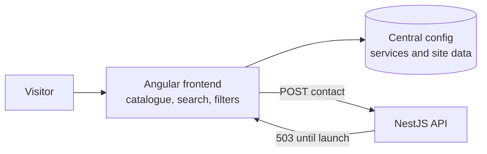

# LuminaTechnik — IT Services Website (Pre-Launch)

> This repository provides a public overview of a privately maintained software project. The source code is not publicly available.

Website for **LuminaTechnik**, a planned IT-services brand of the Lumina group. The site presents a searchable catalogue of eight IT services, from managed IT support to automation and AI integration.

---

## Project Overview

| | |
|---|---|
| **Type** | Web application (frontend + minimal API) |
| **Period** | September – October 2026 |
| **Team** | Solo project |
| **Hosting** | Not deployed yet |

## Problem & Solution

**Problem:** IT services are hard to compare for small businesses; a long text page does not help them find what they need.

**Solution:** A structured service catalogue with search, filters and a detail page per service, driven by central configuration files so that services can be changed without touching components.

## Key Features

- Service catalogue with **search and filters**
- **8 service detail pages** generated from a central data model
- Contact form (frontend validation; delivery deliberately disabled until launch)
- Legal pages and custom 404 page
- Design-token based styling and performance-tuned visual effects
- Image optimisation pipeline

## Technology Stack

| Layer | Technologies |
|---|---|
| Frontend | Angular 21, TypeScript, SCSS design tokens |
| Backend | NestJS 11 (health and contact modules), class-validator |
| Tooling | npm workspaces, Python image optimisation script |
| Testing | API tests with the Node test runner (tsx) |

## System Architecture

The contact endpoint intentionally returns `503 CONTACT_NOT_CONFIGURED` until a delivery channel is set up — nothing is sent or stored before launch.

## My Role & Contributions

Sole developer, responsible for:

- Information architecture and service data model
- Frontend implementation (catalogue, search/filter, detail pages)
- Design system: colour palette iterations and design tokens
- Animation and performance optimisation
- Minimal API with a safe "not configured" default
- Dependency and quality audits

## Development Process

- Every change was planned as a numbered task specification (54 documented tasks)
- AI-assisted development workflow (coding agents) with manual review
- Documented audits for quality, performance and dependencies

See [DEVELOPMENT_LOG.md](DEVELOPMENT_LOG.md).

## Project Status

**Prototype / pre-launch.** The website is feature-complete for a first version but not yet deployed. The brand is listed as "planned" on the Lumina group site.

## Screenshots

No screenshots are published yet; they will be added after launch.

## Technical Challenges & Solutions

| Challenge | Solution |
|---|---|
| Keeping 8 service pages consistent | Single central data source rendered by shared components |
| Visual effects hurting performance | Iterative performance passes; heavy effects partly removed |
| A contact form that must not silently lose messages before launch | API returns an explicit 503 state that the UI handles |

## Skills Demonstrated

`Angular` `TypeScript` `Component architecture` `Data-driven UI` `Design tokens` `SCSS` `Web performance` `NestJS` `npm workspaces` `Python scripting`

---

### About the source code

The original repository is private. This showcase contains documentation only.
